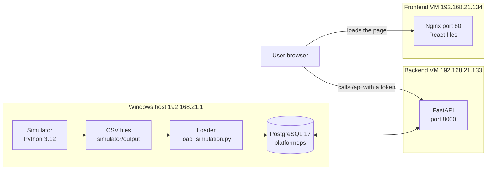

# PlatformOPS V1: single source of truth

This document describes PlatformOPS V1 as it exists in this repository and as it is deployed.
Audience: the internship jury and future developers.

**How to read it**

- Every fact comes from a file of this repository or from a command run on **2026-11-25**.
  Each section ends with its sources.
- Tables between generated-table comments (visible in the raw file) are written by
  `backend/tools/gen_ssot_tables.py`. Do not edit them by hand (section 7.6).
- "**from deploy log 2026-11-25**" marks a fact given by the person who deployed. It comes from
  a terminal or from Jenkins, not from this repository.
- "**NOT VERIFIED FROM REPO**" marks a fact that the repository cannot prove. Each one has a
  number (NV-1 and so on). They are listed in section 8.3.
- Where this document and an older document disagree, the code wins. See section 9.
- Passwords, secrets, tokens and the content of `.env` files are never written here.

**Commits**

| Item | Value |
|---|---|
| Deployed commit (`main`) | `6c13648`, merge of `rebuild` |
| `rebuild` before this document | `4a4bee8` |
| Difference between these two trees | none (`git diff --stat main rebuild` prints nothing) |
| `main` before V1 | `c85ca09` |

**Contents**: [0 Summary](#0-summary) · [1 Infrastructure](#1-infrastructure) ·
[2 Simulator](#2-simulator) · [3 Database](#3-database) · [4 Backend](#4-backend) ·
[5 Frontend](#5-frontend) · [6 CI/CD and deployment](#6-cicd-and-deployment) ·
[7 Operations](#7-operations) · [8 Limitations and decisions](#8-known-limitations-and-design-decisions) ·
[9 Discrepancies](#9-discrepancies-found) · [10 Glossary](#10-glossary)

---

## 0. Summary

1. PlatformOPS is a monitoring platform for a **simulated** Huawei Cloud telemetry system.
2. The cloud system is not deployed. A simulator produces the monitoring data it would emit.
3. The data covers 8 components, 341 metrics and 504 metric columns, for 7 days, one point per minute.
4. Metrics (x) become 33 KPIs (y). Each KPI becomes a health score (h) from 0 to 100.
5. Health scores become 8 component scores (z) and 1 global score (Z).
6. The simulator is deterministic: the same configuration and seed give the same files, byte for byte.
7. A loader checks the files, loads them into PostgreSQL, and computes alerts and incidents.
8. A FastAPI backend serves the data. It has 16 routes under `/api`, with login and two roles.
9. A React application shows scores, KPIs, metrics, alerts, incidents and users.
10. The simulated bad periods are known. All 24 are found: one detected incident each, and no other.

### End-to-end flow



The browser calls the backend directly. Nginx does not forward API calls.

**Sources**: `CLAUDE.md` §1; `docs/PLATFORM_V1.md`; `simulator/README.md`;
`backend/app/main.py`; `platformops-frontend/src/api.ts`; generated tables of sections 2, 3 and 4.

---

## 1. Infrastructure

### 1.1 Machines

| Machine | IP | Ports | Role |
|---|---|---|---|
| Windows host (VMware host) | 192.168.21.1 | 5432 (PostgreSQL) | Database, development, simulator, migrations, data loading |
| cicd VM | 192.168.21.132 | 8080 (Jenkins), 8081 (Nexus) | CI/CD, artifacts, monitoring containers |
| backend VM | 192.168.21.133 | 8000 | FastAPI, run by uvicorn under systemd |
| frontend VM | 192.168.21.134 | 80 | Nginx, static files |

Sources of this table: `CLAUDE.md` §1, and the URLs in `Jenkinsfile`.

### 1.2 Versions

| Where | Software | Version | Proof |
|---|---|---|---|
| Windows host | Windows 10 Pro | 10.0.19045 | `cmd /c ver` |
| Windows host | PostgreSQL | 17.11 | `SELECT version()` on `platformops` |
| Windows host | Python (backend venv) | 3.8.10 | `backend\.venv\Scripts\python -V` |
| Windows host | Python (simulator venv) | 3.12.10 | `simulator\.venv\Scripts\python -V` |
| Windows host | Node / npm | 18.20.8 / 10.8.2 | `node -v`, `npm -v` |
| Windows host | Git | 2.56.1 | `git --version` |
| cicd VM | Jenkins | 2.541.1 | `X-Jenkins` header of port 8080 |
| cicd VM | Nexus | 3.88.0-08 (Community) | `Server` header of port 8081 |
| frontend VM | Nginx | 1.18.0 (Ubuntu) | `Server` header of port 80 |
| cicd and backend VMs | Python | 3.8.10 | `CLAUDE.md` §1 only. **NV-1: NOT VERIFIED FROM REPO** (needs a shell on the VMs) |
| cicd VM | Node / npm | 18.20.8 / 10.8.2 | `CLAUDE.md` §1 only. **NV-1** |
| the 3 VMs | Operating system version | unknown | **NV-2: NOT VERIFIED FROM REPO**. Only the Nginx header says "Ubuntu" |

### 1.3 What runs where

| Part of the repository | Runs on | Deployed by Jenkins |
|---|---|---|
| `simulator/` | Windows host | no |
| `backend/app/`, `backend/requirements.txt` | backend VM | yes |
| `backend/alembic/`, `backend/tools/`, `backend/tests/` | Windows host | no |
| `platformops-frontend/` (the content of `dist/`) | frontend VM | yes |
| `docs/` | nowhere | no |

### 1.4 What V1 did not change

- The `Jenkinsfile`. `git diff c85ca09 6c13648 -- Jenkinsfile` is empty. Its last commit is
  `96765fb` (2026-02-11).
- The rule of the project: nothing on the VMs or in Jenkins may need to change (`CLAUDE.md` §1).
  **NV-3: NOT VERIFIED FROM REPO** that no VM file changed: the VM files are not in this repository.
- The database name `platformops`, its user `platformops`, and the variable names of the VM `.env`
  that the code reads (section 4.2).

V1 changed 565 files in `main`: 14,781 lines added, 49,963 removed
(`git diff --shortstat c85ca09 6c13648`).

### 1.5 Systemd and Nginx

These facts are copied from `CLAUDE.md` §1. The files are on the VMs.
**NV-4: NOT VERIFIED FROM REPO**, except where the last column says otherwise.

| Item | Value in `CLAUDE.md` | Checked today |
|---|---|---|
| systemd unit | `backend` | the name is used by `Jenkinsfile` |
| WorkingDirectory | `/opt/backend/current` | the path is used by `Jenkinsfile` |
| EnvironmentFile | `/opt/backend/shared/.env` | no |
| ExecStart | `/opt/backend/current/venv/bin/uvicorn app.main:app --host 0.0.0.0 --port 8000` | port 8000 answers with `server: uvicorn` |
| Nginx root | `/var/www/frontend/current` | the path is used by `Jenkinsfile` |
| Nginx fallback | `try_files $uri /index.html` | yes: `/some/deep/link` returns the HTML page with 200 |
| API proxy | none | no |

### 1.6 Monitoring stack

Copied from `CLAUDE.md` §1. **NV-5: NOT VERIFIED FROM REPO**: no monitoring configuration is in this
repository.

| Part | Fact |
|---|---|
| Containers on the cicd VM | Prometheus, Grafana, Blackbox, Loki |
| Blackbox | probes the backend `/health` and the frontend `/` |
| Prometheus jobs | `node_exporters`, `cadvisor`, `pushgateway`. They do not scrape the backend application |
| `/metrics` endpoint | not required. The backend has none (section 4.5) |
| `ai-agent` container | reads only node_exporter data through Prometheus. It does not use the backend API |
| Logs | the backend logs to stdout. journald and Loki collect them |

Both probed URLs answered 200 today:

```
GET http://192.168.21.133:8000/health   200  {"status":"ok"}
GET http://192.168.21.134/              200  text/html, 615 bytes
```

**Sources**: `CLAUDE.md` §1 and §2; `Jenkinsfile`; `git log` and `git diff`; HTTP requests to
the 4 addresses above on 2026-11-25.

---

## 2. Simulator

### 2.1 Purpose

The simulator generates 7 days of Huawei Cloud monitoring data: metrics (x), KPIs (y), health (h)
and KQIs (z, Z). It also writes the list of the bad periods. That list is the ground truth, used to
check the detection. It runs on Windows only. It is never deployed.

| Setting | Value | File |
|---|---|---|
| Spec version | 1.2 (frozen) | `simulator/SPEC.md` |
| Seed | 42 | `simulator/config/run.yaml` |
| Start | 2026-11-01T00:00:00Z | `simulator/config/run.yaml` |
| Tick | 60 s | `simulator/config/run.yaml` |
| Ticks | 10,080 (0 to 10,079) | `simulator/config/run.yaml` |
| Bad periods | 3 per component, 24 in total | `simulator/config/run.yaml` |

### 2.2 Scope

<!-- BEGIN GENERATED: sim-components -->

| C | Name | Namespaces | Resources by level | Metrics | Columns | KPIs |
|---|---|---|---|---|---|---|
| C1 | GaussDB(DWS) | SYS.DWS | cluster: `cluster`; node: `node1`, `node2`, `node3` | 22 | 48 | 5 |
| C2 | DMS for Kafka | SYS.DMS | instance: `instance`; broker: `broker1`, `broker2`, `broker3`; topic: `telemetry.metrics.dws.v1`; consumer group: `telemetry-metrics-consumer` | 41 | 87 | 5 |
| C3 | ECS loader host | SYS.ECS + AGT.ECS | server: `loader` | 77 | 77 | 5 |
| C4 | ECS bastion | SYS.ECS | server: `bastion` | 17 | 17 | 3 |
| C5 | OBS | SYS.OBS | bucket: `telemetry-obs-dev` | 95 | 95 | 4 |
| C6 | NAT gateway | SYS.NAT | gateway: `nat` | 17 | 17 | 3 |
| C7 | VPC network | SYS.VPC | EIP / bandwidth: `eip_nat`, `eip_bastion`; subnet: `subnet_public`, `subnet_app`, `subnet_kafka`, `subnet_data`, `subnet_reserved` | 10 | 32 | 3 |
| C8 | CCE | AOM PAAS.AGGR + AOM PAAS.NODE + AOM PAAS.CONTAINER | cluster: `cluster`; node: `node1`, `node2`; container: `metrics-cron`, `logs-cron`, `web-app` | 62 | 131 | 5 |
| **Total** |  |  |  | **341** | **504** | **33** |

<!-- END GENERATED: sim-components -->

A metric column is one metric on one resource. Columns = sum over metrics of the number of resources
of the metric's level.

### 2.3 The model: x → y → h → z → Z

Let $C$ be a component, $r$ a resource, $m$ a metric, $t$ a tick, $k$ a KPI.

**Time**

$$ts(t) = start\_utc + t \times tick\_seconds$$

**Bad period.** A component is bad at tick $t$ when an incident $[s, e]$ of `run.yaml` contains it.
Both ends are included.

$$bad_C(t) = \exists\,[s,e] \in incidents_C : s \le t \le e$$

**Level 1, metrics x.** For a random metric, at an update tick:

$$raw(C,r,m,t) \sim \begin{cases} U(normal_{lo}, normal_{hi}) & \text{if not } bad_C(t) \\ U(bad_{lo}, bad_{hi}) & \text{if } bad_C(t)\end{cases}$$

$$x(C,r,m,t) = round\big(\min(\max(raw, range_{lo}), range_{hi}),\ decimals\big)$$

**Level 2, KPIs y.** Computed only from the written x values, read back from the CSV files. y is not
rounded.

| Type | Formula |
|---|---|
| value | $y = x$ (one metric of one resource) |
| average | $y = \frac{1}{n}\sum_{i=1}^{n} x_i$ |
| maximum | $y = \max(x_1, \dots, x_n)$ |
| ratio | $y = \frac{part}{total} \times 100$. The code stops with an error if $total = 0$ |

In a ratio, `sum(m)` is the sum over the resources of the level. `count(level)` is the number of
resources. `count(m == v)` is the number of resources whose value is $v$.

**Level 3, health h.** With $G$ = good and $B$ = bad. The same formula works for both directions
($G<B$ when lower is better, $G>B$ when higher is better).

$$h = round\left(\min\left(\max\left(0,\ 100\,\frac{y-B}{G-B}\right), 100\right), 2\right)$$

So $h=100$ at $G$ or better, $h=0$ at $B$ or worse, and a straight line in between.

**Level 4, component score z.** $K_C$ is the set of KPIs of component $C$.

$$z_C = round\left(\frac{1}{|K_C|}\sum_{k \in K_C} h_k,\ 2\right)$$

**Level 5, global score Z.** It uses the rounded $z_C$.

$$Z = round\left(\frac{1}{8}\sum_{C=1}^{8} z_C,\ 2\right)$$

**Status.** The band with the highest lower bound that the score reaches. This means: healthy if
score ≥ 80, degraded if 50 ≤ score < 80, critical if score < 50. The bands in `kpis.yaml`:

<!-- BEGIN GENERATED: bands -->

| Status | Low | High |
|---|---|---|
| healthy | 80 | 100 |
| degraded | 50 | 79.99 |
| critical | 0 | 49.99 |

<!-- END GENERATED: bands -->

**Worked example** (it is a unit test, `test_health_worked_example_of_the_specification`):
y = 40, 74, 97, 0.055, 65 give h = 100, 80, 100, 50, 100, so z = 86.

Sums use `math.fsum`, so that results do not depend on the Python version.

### 2.4 Generation kinds

| Kind | Required fields | Raw value at an update tick |
|---|---|---|
| random | `normal`, `bad` | one uniform draw in the normal or the bad interval |
| constant | `value` | the value, always |
| flag | `healthy`, `unhealthy`, `bad_resource` | `unhealthy` on `bad_resource` in a bad period, else `healthy` |
| counter | `start`, and `inc_from` or both `normal_inc` and `bad_inc` | previous raw value (first time: `start`) + increment |
| derived | `expr` | the expression, computed from **written** values |

- A counter increment is a uniform draw in `normal_inc` or `bad_inc`, or the current raw value of the
  metric named by `inc_from` (same resource). Counters add unclamped, unrounded values.
- A derived expression accepts numbers, `+ - * /`, parentheses, metric ids of the same resource, and
  `avg('level','metric')`, `sum('level','metric')`, `ref('level','metric')`. `ref` needs a level with
  one resource. Anything else is rejected when the expression is parsed.
- Order inside a tick: random, constant and flag; then counters; then derived metrics, in topological
  order. A circular reference is an error.
- Derived metrics use clamped and rounded inputs, so written parts add up to written totals.

Metrics by kind and by official period (in minutes):

<!-- BEGIN GENERATED: sim-kinds -->

| C | random | derived | constant | counter | flag | 1 min | 4 min | 5 min | 30 min |
|---|---|---|---|---|---|---|---|---|---|
| C1 | 19 | 1 | 1 | 1 | 0 | 13 | 9 | 0 | 0 |
| C2 | 31 | 5 | 3 | 1 | 1 | 41 | 0 | 0 | 0 |
| C3 | 47 | 26 | 4 | 0 | 0 | 60 | 0 | 17 | 0 |
| C4 | 17 | 0 | 0 | 0 | 0 | 0 | 0 | 17 | 0 |
| C5 | 54 | 33 | 6 | 2 | 0 | 92 | 0 | 0 | 3 |
| C6 | 8 | 9 | 0 | 0 | 0 | 17 | 0 | 0 | 0 |
| C7 | 3 | 6 | 1 | 0 | 0 | 6 | 0 | 0 | 4 |
| C8 | 25 | 27 | 9 | 0 | 1 | 62 | 0 | 0 | 0 |
| **Metrics** | **204** | **107** | **24** | **4** | **2** | **291** | **9** | **34** | **7** |
| Columns by period |  |  |  |  |  | 438 | 9 | 34 | 23 |

<!-- END GENERATED: sim-kinds -->

All the counters and flags:

<!-- BEGIN GENERATED: sim-special -->

| C | Metric | Kind | Values |
|---|---|---|---|
| C1 | `dws007_db_size` | counter | start 51200; increment: normal [2, 6], bad [0, 1] |
| C2 | `broker_alive` | flag | 1 (healthy); 0 on `broker3` in a bad period |
| C2 | `consumer_messages_consumed` | counter | start 0; increment: current value of `consumer_messages_consumed_per_min` |
| C5 | `capacity_total` | counter | start 5000000000; increment: normal [300000.0, 600000.0], bad [0, 100000.0] |
| C5 | `object_num_all` | counter | start 2000; increment: normal [0, 1], bad [0, 0] |
| C8 | `aom_process_status` | flag | 0 (healthy); 1 on `metrics-cron` in a bad period |

<!-- END GENERATED: sim-special -->

### 2.5 Determinism

Each (component, resource, metric) has its own random stream:

$$rng = Random\Big(int\big(hex(SHA256(\text{"seed|component|resource|metric"}))[0{:}16],\ 16\big)\Big)$$

- The seed of the stream is the first 16 hexadecimal digits (64 bits) of the hash.
- There is one `rng.uniform(lo, hi)` draw per update.
- Adding or removing a metric does not change the streams of the others.
- **Period rule**: a metric is recomputed only when $t \bmod period\_min = 0$. Otherwise it keeps its
  value. The bad state is read at the update tick, so a held value can stay bad after the incident.
- **Clamp and round**: clamp to `official_range`, then `round(value, decimals)`.
- Files are written with `\n` line ends and a fixed number of decimals, on every platform.

Checked today: a new run in an empty folder gave the same `manifest.json` (so the same SHA-256 for
every file) as `simulator/output/`.

### 2.6 Incident schedule (bad periods)

<!-- BEGIN GENERATED: incidents -->

| C | Ticks (included) | Start UTC | End UTC | Minutes |
|---|---|---|---|---|
| C1 | 300–329 | 2026-11-01 05:00 | 2026-11-01 05:29 | 30 |
| C1 | 3500–3544 | 2026-11-03 10:20 | 2026-11-03 11:04 | 45 |
| C1 | 6700–6759 | 2026-11-05 15:40 | 2026-11-05 16:39 | 60 |
| C2 | 700–744 | 2026-11-01 11:40 | 2026-11-01 12:24 | 45 |
| C2 | 3900–3959 | 2026-11-03 17:00 | 2026-11-03 17:59 | 60 |
| C2 | 7100–7129 | 2026-11-05 22:20 | 2026-11-05 22:49 | 30 |
| C3 | 1100–1159 | 2026-11-01 18:20 | 2026-11-01 19:19 | 60 |
| C3 | 4300–4329 | 2026-11-03 23:40 | 2026-11-04 00:09 | 30 |
| C3 | 7500–7544 | 2026-11-06 05:00 | 2026-11-06 05:44 | 45 |
| C4 | 1500–1529 | 2026-11-02 01:00 | 2026-11-02 01:29 | 30 |
| C4 | 4700–4744 | 2026-11-04 06:20 | 2026-11-04 07:04 | 45 |
| C4 | 7900–7959 | 2026-11-06 11:40 | 2026-11-06 12:39 | 60 |
| C5 | 1900–1944 | 2026-11-02 07:40 | 2026-11-02 08:24 | 45 |
| C5 | 5100–5159 | 2026-11-04 13:00 | 2026-11-04 13:59 | 60 |
| C5 | 8300–8329 | 2026-11-06 18:20 | 2026-11-06 18:49 | 30 |
| C6 | 2300–2359 | 2026-11-02 14:20 | 2026-11-02 15:19 | 60 |
| C6 | 5500–5529 | 2026-11-04 19:40 | 2026-11-04 20:09 | 30 |
| C6 | 8700–8744 | 2026-11-07 01:00 | 2026-11-07 01:44 | 45 |
| C7 | 2700–2729 | 2026-11-02 21:00 | 2026-11-02 21:29 | 30 |
| C7 | 5900–5944 | 2026-11-05 02:20 | 2026-11-05 03:04 | 45 |
| C7 | 9100–9159 | 2026-11-07 07:40 | 2026-11-07 08:39 | 60 |
| C8 | 3100–3144 | 2026-11-03 03:40 | 2026-11-03 04:24 | 45 |
| C8 | 6300–6359 | 2026-11-05 09:00 | 2026-11-05 09:59 | 60 |
| C8 | 9500–9529 | 2026-11-07 14:20 | 2026-11-07 14:49 | 30 |

<!-- END GENERATED: incidents -->

No two bad periods overlap, in any component.

### 2.7 Output files

All in `simulator/output/`, not in git.

<!-- BEGIN GENERATED: outputs -->

| File | Rows | Columns | Header | Bytes | SHA-256 |
|---|---|---|---|---|---|
| `x/C1_dws.csv` | 10,080 | 50 | tick, timestamp_utc, cluster.dws001_shared_buffer_hit_ratio, … | 3,961,118 | `cc2441f4ba4d…` |
| `x/C2_kafka.csv` | 10,080 | 89 | tick, timestamp_utc, instance.current_partitions, … | 5,680,433 | `eaabe5a3db33…` |
| `x/C3_ecs_loader.csv` | 10,080 | 79 | tick, timestamp_utc, loader.cpu_util, … | 4,854,759 | `54173f4fac44…` |
| `x/C4_ecs_bastion.csv` | 10,080 | 19 | tick, timestamp_utc, bastion.cpu_util, … | 1,360,113 | `8f1ad8489f78…` |
| `x/C5_obs.csv` | 10,080 | 97 | tick, timestamp_utc, telemetry-obs-dev.get_request_count, … | 6,406,523 | `33a17038b6fa…` |
| `x/C6_nat.csv` | 10,080 | 19 | tick, timestamp_utc, nat.snat_connection, … | 1,474,679 | `3ddc9771c833…` |
| `x/C7_vpc.csv` | 10,080 | 34 | tick, timestamp_utc, eip_nat.upstream_bandwidth, … | 2,169,167 | `dcd1d7d7c726…` |
| `x/C8_cce.csv` | 10,080 | 133 | tick, timestamp_utc, cluster.aom_cluster_cpu_limit_core, … | 9,674,586 | `ca1b6572799c…` |
| `y_kpis.csv` | 332,640 | 6 | tick, timestamp_utc, component, kpi_id, value, health | 17,577,177 | `53ead8de63c1…` |
| `z_kqis.csv` | 10,080 | 12 | tick, timestamp_utc, C1, C2, C3, C4, C5, C6, C7, C8, global, status | 957,829 | `d2f6ee001093…` |
| `labels.csv` | 24 | 6 | component, start_tick, end_tick, start_utc, end_utc, description | 2,069 | `9f29c79c6488…` |
| 11 files + `manifest.json` |  |  |  | **54,118,453** |  |

<!-- END GENERATED: outputs -->

- x files are wide: one column per `<resource>.<metric_id>`. Resource names can contain dots, so a
  column name is split on its last dot.
- `y_kpis.csv` is long: one row per tick and KPI. 10,080 × 33 = 332,640 rows.
- `z_kqis.csv`: `status` is the status of `global`.
- `labels.csv`: one row per bad period, ends included.
- `manifest.json`: seed, start, ticks, and the row count and SHA-256 of every other file.

### 2.8 Validation: the 19 checks

`validate` reads only the output files, the configuration and the catalog. It does not import the
generator, the KPI or the KQI code: the formulas are written a second time, on purpose, so that an
error cannot hide itself. Result today: **19/19 checks passed** in 35 s.

<!-- BEGIN GENERATED: checks -->

| # | Check | Function |
|---|---|---|
| 1 | x: 8 files, 10,080 rows, ticks and timestamps | `check_x_shape` |
| 2 | x: 504 columns, in-scope catalog x resources | `check_x_columns` |
| 3 | x: values inside official_range | `check_x_ranges` |
| 4 | x: values inside the catalog value_range | `check_x_catalog_ranges` |
| 5 | x: decimals, counts are whole numbers | `check_x_decimals` |
| 6 | x: values change only on their period | `check_x_periods` |
| 7 | x: random and flag values follow the incidents | `check_x_incidents` |
| 8 | x: constants never change | `check_x_constants` |
| 9 | x: growing totals never go down | `check_x_counters` |
| 10 | x: paired values add up | `check_x_pairs` |
| 11 | x: derived columns match their expression | `check_x_derived` |
| 12 | y: 332,640 rows, one per tick and KPI | `check_y_rows` |
| 13 | y: KPI values and health recomputed from x | `check_y_values` |
| 14 | z: 10,080 rows, ticks and timestamps | `check_z_rows` |
| 15 | z: component and global KQIs recomputed from y | `check_z_values` |
| 16 | z: status matches the bands | `check_z_status` |
| 17 | z: at least 30 points below normal in incidents | `check_z_drop` |
| 18 | labels match the incidents of run.yaml | `check_labels` |
| 19 | manifest: settings, row counts and sha256 | `check_manifest` |

<!-- END GENERATED: checks -->

Paired values (check 10): C3 `disk_used + disk_free = disk_total`, C3 `cpu_usage + cpu_usage_idle = 100`,
C7 `used_number + remain_number = total_number` for each subnet. "Two runs give identical files" is a
test, because it needs the generator.

### 2.9 Tests

| File | What it covers | Tests |
|---|---|---|
| `test_expr.py` | allowed expressions, collected references, 30 rejected expressions | 39 |
| `test_kpis.py` | health in both directions, every KPI type, rejected KPIs, KQI means, status bands | 39 |
| `test_run.py` | two identical full runs, full run passes validate, validate fails on wrong and on missing output | 4 |

Result today: **82 passed** in 105.56 s.

### 2.10 Commands

From `simulator/`:

```powershell
py -3.12 -m venv .venv                                             # once
.venv\Scripts\python -m pip install pyyaml==6.0.4 pytest==9.2.0    # once
.venv\Scripts\python -m simulator run
.venv\Scripts\python -m simulator validate
.venv\Scripts\python -m pytest -q
```

Measured today: `run` took 20.5 s. Both commands accept `--output <folder>`.

| File | Role |
|---|---|
| `simulator/__main__.py` | command line: run, validate |
| `simulator/config.py` | loads and checks the frozen configuration |
| `simulator/expr.py` | safe evaluator of the derived expressions |
| `simulator/generator.py` | metrics x |
| `simulator/kpis.py` | KPIs y and health h |
| `simulator/kqis.py` | scores z and Z, status |
| `simulator/writer.py` | output files |
| `simulator/validate.py` | the 19 checks |

### 2.11 Catalog

<!-- BEGIN GENERATED: sim-catalog -->

The catalog has 356 rows: 341 in scope, 15 out of scope (one row can stand for a group of metrics).

| C | Out of scope | Reason in the catalog |
|---|---|---|
| C2 | `partition_messages` | partition detail; topic-level metrics cover it |
| C2 | `produced_messages` | partition detail; topic-level metrics cover it |
| C2 | `partition_messages_in_rate` | partition detail; topic-level metrics cover it |
| C2 | `messages_consumed` | partition detail; group-level metrics cover it |
| C2 | `messages_remained` | partition detail; group-level metrics cover it |
| C2 | `messages_consumed_per_min` | partition detail; group-level metrics cover it |
| C5 | `capacity_infrequent_access` | bucket uses Standard storage only |
| C5 | `capacity_archive` | bucket uses Standard storage only |
| C5 | `capacity_deep_archive` | bucket uses Standard storage only |
| C5 | `object_num_infrequent_access_total` | bucket uses Standard storage only |
| C5 | `object_num_archive_total` | bucket uses Standard storage only |
| C5 | `object_num_deep_archive_total` | bucket uses Standard storage only |
| C5 | `bucket_intranet_* / bucket_extranet_* (36 metrics)` | split view of the bucket_total_* QoS metrics; thresholds are constants |
| C5 | `cdn_*, get_mirror_*, infrequent_*/archive_* request metrics, tenant_total_* QoS` | features not used by this bucket / account-level |
| C8 | `aom_container_gpu_* / aom_container_npu_* (8 metrics)` | no GPU/NPU on the 2 vCPU / 4 GB nodes |

| C | Official source (column `source`) |
|---|---|
| C1 | https://support.huaweicloud.com/intl/en-us/mgtg-dws/dws_01_0022.html |
| C2 | https://support.huaweicloud.com/intl/en-us/usermanual-kafka/kafka-ug-180413002.html |
| C3 | https://support.huaweicloud.com/intl/en-us/usermanual-ecs/ecs_03_1002.html |
| C3 | https://support.huaweicloud.com/intl/en-us/usermanual-ecs/ecs_03_1003.html |
| C4 | https://support.huaweicloud.com/intl/en-us/usermanual-ecs/ecs_03_1002.html |
| C5 | https://support.huaweicloud.com/intl/en-us/usermanual-obs/obs_03_0010.html |
| C6 | https://support.huaweicloud.com/intl/en-us/usermanual-natgateway/nat_ces_0002.html |
| C7 | https://support.huaweicloud.com/intl/en-us/usermanual-vpc/vpc010012.html |
| C8 | https://support.huaweicloud.com/eu/productdesc-aom2/aom_01_0022.html |
| C8 | https://support.huaweicloud.com/intl/en-us/productdesc-aom/aom_06_0018.html |

<!-- END GENERATED: sim-catalog -->

### 2.12 Appendix: the KPIs

<!-- BEGIN GENERATED: kpi-types -->

33 KPIs. By type: 17 value, 10 maximum, 3 average, 3 ratio. By signal: 19 saturation, 7 latency, 6 errors, 1 traffic.

<!-- END GENERATED: kpi-types -->

<!-- BEGIN GENERATED: kpis -->

| C | KPI | Name | Signal | Type | Level | y = | G | B | Better |
|---|---|---|---|---|---|---|---|---|---|
| C1 | `dws_cpu` | CPU load | saturation | average | node | `mean(dws010_cpu_usage) over 3 × node` | 60 | 90 | lower |
| C1 | `dws_mem` | Memory load | saturation | average | node | `mean(dws011_mem_usage) over 3 × node` | 70 | 90 | lower |
| C1 | `dws_disk` | Disk fill | saturation | maximum | node | `max(dws015_disk_usage) over 3 × node` | 70 | 90 | lower |
| C1 | `dws_cache` | Cache efficiency | latency | value | cluster | `dws001_shared_buffer_hit_ratio` | 95 | 80 | higher |
| C1 | `dws_io_wait` | Disk write latency | latency | maximum | node | `max(dws021_avg_disk_sec_per_write) over 3 × node` | 0.01 | 0.1 | lower |
| C2 | `kafka_backlog` | Consumer backlog | latency | value | consumer group | `consumer_messages_remained` | 1000 | 100000 | lower |
| C2 | `kafka_disk` | Broker disk fill | saturation | maximum | broker | `max(broker_disk_usage) over 3 × broker` | 70 | 90 | lower |
| C2 | `kafka_cpu` | Broker CPU | saturation | average | broker | `mean(broker_cpu_usage) over 3 × broker` | 60 | 90 | lower |
| C2 | `kafka_alive` | Brokers alive | errors | ratio | broker | `100 × (sum(broker_alive)) / (count(broker))` | 100 | 66 | higher |
| C2 | `kafka_produce_lat` | Produce latency | latency | maximum | broker | `max(broker_produce_mean) over 3 × broker` | 10 | 100 | lower |
| C3 | `ldr_cpu` | CPU load | saturation | value | server | `cpu_usage` | 60 | 90 | lower |
| C3 | `ldr_mem` | Memory load | saturation | value | server | `mem_usedPercent` | 70 | 90 | lower |
| C3 | `ldr_disk` | Disk fill | saturation | value | server | `disk_usedPercent` | 70 | 90 | lower |
| C3 | `ldr_iowait` | I/O wait | latency | value | server | `cpu_usage_iowait` | 5 | 30 | lower |
| C3 | `ldr_retrans` | TCP retransmission | errors | value | server | `net_tcp_retrans` | 1 | 5 | lower |
| C4 | `bst_cpu` | CPU load | saturation | value | server | `cpu_util` | 60 | 90 | lower |
| C4 | `bst_disk` | Disk fill | saturation | value | server | `disk_util_inband` | 70 | 90 | lower |
| C4 | `bst_conn` | Open connections | traffic | value | server | `network_vm_connections` | 50 | 500 | lower |
| C5 | `obs_err` | Error rate | errors | ratio | bucket | `100 × (request_count_4xx + request_count_5xx) / (get_request_count + put_request_count + post_request_count + head_request_count + delete_request_count)` | 1 | 5 | lower |
| C5 | `obs_success` | Request success | errors | value | bucket | `request_success_rate` | 99.9 | 95 | higher |
| C5 | `obs_latency` | Request latency | latency | value | bucket | `total_request_latency` | 100 | 1000 | lower |
| C5 | `obs_first_byte` | First byte delay | latency | value | bucket | `first_byte_latency` | 50 | 500 | lower |
| C6 | `nat_snat` | SNAT connection usage | saturation | value | gateway | `snat_connection_ratio` | 50 | 80 | lower |
| C6 | `nat_out_bw` | Outbound bandwidth usage | saturation | value | gateway | `outbound_bandwidth_ratio` | 60 | 90 | lower |
| C6 | `nat_drops` | Dropped packets | errors | maximum | gateway | `max(packets_drop_count_snat_connection_beyond, packets_drop_count_pps_beyond, packets_drop_count_eip_port_alloc_beyond)` | 0 | 100 | lower |
| C7 | `eip_out` | EIP outbound usage | saturation | maximum | EIP / bandwidth | `max(upstream_bandwidth_usage) over 2 × EIP / bandwidth` | 60 | 90 | lower |
| C7 | `eip_in` | EIP inbound usage | saturation | maximum | EIP / bandwidth | `max(downstream_bandwidth_usage) over 2 × EIP / bandwidth` | 60 | 90 | lower |
| C7 | `subnet_ip` | Subnet IP usage | saturation | maximum | subnet | `max(subnet_ipv4_availability_usage_percentage) over 5 × subnet` | 70 | 90 | lower |
| C8 | `cce_cpu` | Cluster CPU | saturation | value | cluster | `aom_cluster_cpu_usage` | 60 | 90 | lower |
| C8 | `cce_mem` | Cluster memory | saturation | value | cluster | `aom_cluster_memory_usage` | 70 | 90 | lower |
| C8 | `cce_node_disk` | Node disk fill | saturation | maximum | node | `max(aom_node_disk_usage) over 2 × node` | 70 | 90 | lower |
| C8 | `cce_pod_mem` | Workload memory | saturation | maximum | container | `max(aom_container_memory_usage) over 3 × container` | 70 | 90 | lower |
| C8 | `cce_workloads_ok` | Workloads healthy | errors | ratio | container | `100 × (count(aom_process_status == 0)) / (count(container))` | 100 | 66 | higher |

<!-- END GENERATED: kpis -->

**Sources**: `simulator/config/run.yaml`, `simulator/config/kpis.yaml`,
`simulator/config/components/*.yaml`, `simulator/catalog/huawei_metrics_catalog.csv`,
`simulator/simulator/*.py`, `simulator/tests/*.py`, `simulator/README.md`, `simulator/SPEC.md`,
`simulator/output/manifest.json`; commands `simulator run --output`, `simulator validate`, `pytest -q`
on 2026-11-25.

---

## 3. Database

PostgreSQL on the Windows host. The schema is defined by the Alembic migrations and by the models in
`backend/app/db/models.py`.

- Points do not store a timestamp: $ts = start\_utc + tick \times tick\_seconds$.
- Every `end_tick` is included in its interval.
- The server time zone is not UTC. The API converts every timestamp to UTC.

### 3.1 Tables (from the models)

"serial" means that PostgreSQL gives the next integer.

<!-- BEGIN GENERATED: schema -->

**`auth_secret`**

| Column | Type | Null | Keys | Default |
|---|---|---|---|---|
| `id` | integer | no | PK |  |
| `value` | text | no |  |  |
| `created_at` | timestamp with time zone | no |  | now() |

Check `auth_secret_single_row_check`: `id = 1`

**`components`**

| Column | Type | Null | Keys | Default |
|---|---|---|---|---|
| `id` | varchar(2) | no | PK |  |
| `name` | text | no |  |  |
| `namespace` | text | no |  |  |

**`kqi_points`**

| Column | Type | Null | Keys | Default |
|---|---|---|---|---|
| `scope` | text | no | PK |  |
| `tick` | integer | no | PK |  |
| `z` | double precision | no |  |  |
| `status` | text | no |  |  |

**`simulation_run`**

| Column | Type | Null | Keys | Default |
|---|---|---|---|---|
| `id` | integer | no | PK | serial |
| `spec_version` | text | no |  |  |
| `seed` | integer | no |  |  |
| `start_utc` | timestamp with time zone | no |  |  |
| `tick_seconds` | integer | no |  |  |
| `ticks` | integer | no |  |  |
| `loaded_at` | timestamp with time zone | no |  | now() |
| `manifest_sha256` | varchar(64) | no |  |  |

**`users`**

| Column | Type | Null | Keys | Default |
|---|---|---|---|---|
| `id` | integer | no | PK | serial |
| `username` | text | no | unique |  |
| `password_hash` | text | no |  |  |
| `role` | text | no |  |  |
| `created_at` | timestamp with time zone | no |  | now() |

Check `users_role_check`: `role IN ('admin', 'viewer')`

**`incidents`**

| Column | Type | Null | Keys | Default |
|---|---|---|---|---|
| `id` | integer | no | PK | serial |
| `component_id` | varchar(2) | no | FK → components.id |  |
| `start_tick` | integer | no |  |  |
| `end_tick` | integer | no |  |  |
| `alert_count` | integer | no |  |  |
| `min_z` | double precision | no |  |  |

**`kpis`**

| Column | Type | Null | Keys | Default |
|---|---|---|---|---|
| `id` | text | no | PK |  |
| `component_id` | varchar(2) | no | FK → components.id, index |  |
| `name` | text | no |  |  |
| `signal` | text | no |  |  |
| `type` | text | no |  |  |
| `level` | text | no |  |  |
| `input` | text | no |  |  |
| `good` | double precision | no |  |  |
| `bad` | double precision | no |  |  |
| `better` | text | no |  |  |

**`metrics`**

| Column | Type | Null | Keys | Default |
|---|---|---|---|---|
| `id` | integer | no | PK | serial |
| `component_id` | varchar(2) | no | FK → components.id, index |  |
| `level` | text | no |  |  |
| `resource` | text | no |  |  |
| `metric_id` | text | no |  |  |
| `name` | text | no |  |  |
| `unit` | text | no |  |  |
| `range_min` | double precision | no |  |  |
| `range_max` | double precision | yes |  |  |
| `period_min` | integer | no |  |  |
| `decimals` | integer | no |  |  |
| `column_name` | text | no | unique |  |

**`simulated_incidents`**

| Column | Type | Null | Keys | Default |
|---|---|---|---|---|
| `id` | integer | no | PK | serial |
| `component_id` | varchar(2) | no | FK → components.id |  |
| `start_tick` | integer | no |  |  |
| `end_tick` | integer | no |  |  |
| `description` | text | no |  |  |

**`alerts`**

| Column | Type | Null | Keys | Default |
|---|---|---|---|---|
| `id` | integer | no | PK | serial |
| `kpi_id` | text | no | FK → kpis.id |  |
| `component_id` | varchar(2) | no | FK → components.id |  |
| `start_tick` | integer | no |  |  |
| `end_tick` | integer | no |  |  |
| `min_health` | double precision | no |  |  |

**`kpi_points`**

| Column | Type | Null | Keys | Default |
|---|---|---|---|---|
| `kpi_id` | text | no | PK, FK → kpis.id |  |
| `tick` | integer | no | PK |  |
| `value` | double precision | no |  |  |
| `health` | double precision | no |  |  |

**`metric_points`**

| Column | Type | Null | Keys | Default |
|---|---|---|---|---|
| `metric_id` | integer | no | PK, FK → metrics.id |  |
| `tick` | integer | no | PK |  |
| `value` | double precision | no |  |  |

<!-- END GENERATED: schema -->

| Table | Content |
|---|---|
| `simulation_run` | settings of the loaded run and the SHA-256 of its manifest |
| `components` | C1 to C8. `namespace` joins the namespaces of its metrics with ` + ` |
| `metrics` | one row per resource and metric. `column_name` = `<component>.<resource>.<metric_id>` |
| `metric_points` | x |
| `kpis` | definition of each KPI. `input` is a metric id, or JSON for a list or a ratio |
| `kpi_points` | y and h |
| `kqi_points` | z and status. `scope` is C1 to C8 or `GLOBAL` |
| `simulated_incidents` | `labels.csv`, the ground truth. Never used to detect |
| `alerts`, `incidents` | computed by the loader |
| `users` | accounts (password hash only) |
| `auth_secret` | the secret that signs the login tokens: one row |

### 3.2 Live content of the deployed database

Read today from the **deployed** database `platformops`, with `DB_NAME=platformops`, in a read-only
transaction. The database `platformops_dev` does not exist today. `platformops_old` exists.
`platformops` and `platformops_old` are owned by the user `platformops`.

<!-- BEGIN GENERATED: database -->

Read from database `platformops` (PostgreSQL 17.11), Alembic version `0002`, size 536,532,659 bytes.

| Table | Rows (count) | Bytes with indexes |
|---|---|---|
| `alembic_version` | 1 | 24,576 |
| `alerts` | 99 | 32,768 |
| `auth_secret` | 1 | 32,768 |
| `components` | 8 | 32,768 |
| `incidents` | 24 | 24,576 |
| `kpi_points` | 332,640 | 34,521,088 |
| `kpis` | 33 | 49,152 |
| `kqi_points` | 90,720 | 7,290,880 |
| `metric_points` | 5,080,320 | 485,826,560 |
| `metrics` | 504 | 253,952 |
| `simulated_incidents` | 24 | 32,768 |
| `simulation_run` | 1 | 32,768 |
| `users` | 1 | 49,152 |

Indexes:

| Index | Table | Columns |
|---|---|---|
| `alembic_version_pkc` | `alembic_version` | unique (version_num) |
| `alerts_pkey` | `alerts` | unique (id) |
| `auth_secret_pkey` | `auth_secret` | unique (id) |
| `components_pkey` | `components` | unique (id) |
| `incidents_pkey` | `incidents` | unique (id) |
| `kpi_points_pkey` | `kpi_points` | unique (kpi_id, tick) |
| `ix_kpis_component_id` | `kpis` | (component_id) |
| `kpis_pkey` | `kpis` | unique (id) |
| `kqi_points_pkey` | `kqi_points` | unique (scope, tick) |
| `metric_points_pkey` | `metric_points` | unique (metric_id, tick) |
| `ix_metrics_component_id` | `metrics` | (component_id) |
| `metrics_column_name_key` | `metrics` | unique (column_name) |
| `metrics_pkey` | `metrics` | unique (id) |
| `simulated_incidents_pkey` | `simulated_incidents` | unique (id) |
| `simulation_run_pkey` | `simulation_run` | unique (id) |
| `users_pkey` | `users` | unique (id) |
| `users_username_key` | `users` | unique (username) |

Scores: number of ticks by status. "In" = inside a simulated incident.

| Scope | healthy | degraded | critical | min z | mean z | mean z in | mean z out |
|---|---|---|---|---|---|---|---|
| C1 | 9945 | 0 | 135 | 0.00 | 98.65 | 0.87 | 99.98 |
| C2 | 9945 | 0 | 135 | 0.39 | 98.66 | 0.39 | 99.99 |
| C3 | 9945 | 0 | 135 | 0.00 | 98.43 | 0.00 | 99.76 |
| C4 | 9945 | 0 | 135 | 0.00 | 98.66 | 0.00 | 100.00 |
| C5 | 9945 | 0 | 135 | 0.00 | 98.25 | 0.00 | 99.59 |
| C6 | 9945 | 0 | 135 | 0.00 | 98.66 | 0.00 | 100.00 |
| C7 | 9900 | 45 | 135 | 0.00 | 98.61 | 7.41 | 99.85 |
| C8 | 9945 | 0 | 135 | 0.39 | 97.70 | 0.39 | 99.02 |
| GLOBAL | 10080 | 0 | 0 | 86.39 | 98.45 |  | 98.45 |

Detected incidents, with the simulated incident that each one overlaps:

| C | Simulated ticks | Detected ticks | End lag (ticks) | Alerts | Min z |
|---|---|---|---|---|---|
| C1 | 300–329 | 300–331 | 2 | 5 | 0.00 |
| C1 | 3500–3544 | 3500–3547 | 3 | 5 | 0.00 |
| C1 | 6700–6759 | 6700–6759 | 0 | 5 | 0.00 |
| C2 | 700–744 | 700–744 | 0 | 5 | 0.39 |
| C2 | 3900–3959 | 3900–3959 | 0 | 5 | 0.39 |
| C2 | 7100–7129 | 7100–7129 | 0 | 5 | 0.39 |
| C3 | 1100–1159 | 1100–1159 | 0 | 5 | 0.00 |
| C3 | 4300–4329 | 4300–4329 | 0 | 5 | 0.00 |
| C3 | 7500–7544 | 7500–7544 | 0 | 5 | 0.00 |
| C4 | 1500–1529 | 1500–1529 | 0 | 3 | 0.00 |
| C4 | 4700–4744 | 4700–4744 | 0 | 3 | 0.00 |
| C4 | 7900–7959 | 7900–7959 | 0 | 3 | 0.00 |
| C5 | 1900–1944 | 1900–1944 | 0 | 4 | 0.00 |
| C5 | 5100–5159 | 5100–5159 | 0 | 4 | 0.00 |
| C5 | 8300–8329 | 8300–8329 | 0 | 4 | 0.00 |
| C6 | 2300–2359 | 2300–2359 | 0 | 3 | 0.00 |
| C6 | 5500–5529 | 5500–5529 | 0 | 3 | 0.00 |
| C6 | 8700–8744 | 8700–8744 | 0 | 3 | 0.00 |
| C7 | 2700–2729 | 2700–2729 | 0 | 3 | 0.00 |
| C7 | 5900–5944 | 5900–5969 | 25 | 3 | 0.00 |
| C7 | 9100–9159 | 9100–9179 | 20 | 3 | 0.00 |
| C8 | 3100–3144 | 3100–3144 | 0 | 5 | 0.39 |
| C8 | 6300–6359 | 6300–6359 | 0 | 5 | 0.39 |
| C8 | 9500–9529 | 9500–9529 | 0 | 5 | 0.39 |

<!-- END GENERATED: database -->

Results that follow from these tables:

- 99 alerts = 33 KPIs × 3 bad periods. 24 incidents = 8 components × 3 bad periods.
- Each detected incident starts at the same tick as its simulated incident.
- 4 of the 24 end later: C1 by 2 and 3 ticks (4-minute metrics), C7 by 25 and 20 ticks (30-minute
  metrics). The other 20 end at the same tick.
- The 45 degraded ticks of C7 are these 25 + 20 ticks.
- Global Z is healthy at every tick. Its minimum is 86.39.

### 3.3 Migrations

| Revision | Parent | Content |
|---|---|---|
| `0001` | none | 11 tables: all except `auth_secret`. Two indexes on `component_id` (`metrics`, `kpis`). Check on `users.role` |
| `0002` | `0001` | table `auth_secret`, with the check `id = 1` (one row at most) |

- Both have a `downgrade`.
- `alembic/env.py` uses `target_engine()`, so the target must be chosen (section 3.6). Offline mode is
  refused.
- `alembic.ini` contains no database URL.

### 3.4 Loader: `backend/tools/load_simulation.py`

Everything runs in **one transaction**. An error leaves the database as it was.

1. Read `run.yaml`. Check `manifest.json` against it (seed, start, ticks) and check the list of files.
   Check the SHA-256 and the row count of every file.
2. Check that the configured metrics (component, id, unit) are exactly the in-scope metrics of the catalog.
3. `TRUNCATE … RESTART IDENTITY` the 10 data tables. `users` and `auth_secret` are never truncated.
4. Insert `simulation_run`. The spec version is read from `simulator/SPEC.md`.
5. For each component: insert the component and its metrics, then COPY the points of each column.
6. Insert the KPIs, COPY `kpi_points`, and check that ticks are in order.
7. COPY `kqi_points`. The status of each scope is computed from the bands. The global status must
   equal the one in `z_kqis.csv`.
8. Insert `simulated_incidents` from `labels.csv`.
9. Compute and insert alerts and incidents.
10. Create the token secret, if there is none.
11. Optional: `--admin-password` creates or updates the user `admin`.
12. Check the row counts of 8 tables (all the loaded ones except `alerts` and `incidents`). Commit.
13. Print the row counts and a comparison of simulated and detected incidents. The exit code is 0 only
    if every simulated incident has exactly one detected incident and there is no extra one.

Duration of a load: **NV-6: NOT VERIFIED FROM REPO**. It was not run today, because the only V1
database is the deployed one.

### 3.5 Detection rules

**Alert**, per KPI. An alert is a maximal run of consecutive ticks with $h < 50$:

$$alert = [a,b] : \forall t \in [a,b],\ h_k(t) < 50 \qquad min\_health = \min_{t \in [a,b]} h_k(t)$$

An alert that is still open at the last tick ends there.

**Incident**, per component. Alerts are sorted by start. The next alert joins the current incident if

$$start_{next} - end_{current} \le 5$$

$alert\_count$ is the number of merged alerts, and $min\_z = \min_{t \in [start,end]} z_C(t)$.

**Match.** A detected and a simulated incident match when they have the same component and their
intervals overlap.

### 3.6 Safety guards

| Guard | Where |
|---|---|
| Alembic, the loader and `create_user` stop if `DB_NAME` is not set in the environment or in `backend/.env.local`. The default would be the deployed database | `tools/database.py` |
| The tools print the target database before they act | `tools/database.py` |
| One transaction for the load | `load_simulation.py` |
| `users` and `auth_secret` are never truncated | `load_simulation.py` (`LOADED`) |
| Files are checked by SHA-256 and row count before anything changes | `check_manifest` |
| The integration tests run only if `DB_NAME` is `platformops_dev`. They roll back everything | `tests/conftest.py` |
| Check constraints on `users.role` and `auth_secret.id` | migrations |

### 3.7 `auth_secret`

The loader writes 32 random bytes in hexadecimal (`secrets.token_hex(32)`), with
`ON CONFLICT DO NOTHING`. It is created once and never replaced by the loader.

**Sources**: `backend/app/db/models.py`, `backend/alembic/`, `backend/alembic.ini`,
`backend/tools/load_simulation.py`, `backend/tools/database.py`, `backend/tests/conftest.py`;
read-only queries on `platformops` on 2026-11-25.

---

## 4. Backend

### 4.1 Architecture

| Path (in `backend/`) | Role |
|---|---|
| `app/main.py` | the FastAPI app, CORS, error handlers, `GET /health` |
| `app/core/config.py` | DB settings and CORS origins |
| `app/core/db.py` | engine (created on first use) and one session per request |
| `app/core/errors.py` | one JSON shape for every error |
| `app/core/security.py` | password hashes and tokens, standard library only |
| `app/db/models.py` | SQLAlchemy models |
| `app/api/router.py` | all `/api` routes. Protects everything except `auth` |
| `app/api/deps.py` | current user, admin check, run, time window, component filter |
| `app/api/auth.py` | login, me |
| `app/api/scores.py` | run, overview, KQI series, components, KPI series |
| `app/api/metrics.py` | metric search and series |
| `app/api/detections.py` | alerts and incidents |
| `app/api/users.py` | user management |
| `app/schemas/*.py` | pydantic models: `auth`, `detections`, `metrics`, `scores` |
| `app/services/timeline.py` | run, timestamp ↔ tick, windows and buckets |
| `app/services/scores.py` | queries on KPIs and KQIs |
| `app/services/metrics.py` | queries on metrics |
| `app/services/detections.py` | queries on alerts and incidents |
| `app/services/users.py` | login, token check, accounts |
| `tools/`, `alembic/`, `tests/` | Windows only, not shipped |

Layers: `api` (HTTP) → `services` (queries) → `db` (models). The API computes no score: it reads what
the loader stored.

<!-- BEGIN GENERATED: files -->

| Folder | Tracked files | Lines |
|---|---|---|
| `simulator/simulator/` | 9 | 1,194 |
| `simulator/tests/` | 3 | 275 |
| `simulator/config/` | 10 | 5,622 |
| `backend/app/` | 28 | 1,194 |
| `backend/alembic/` | 4 | 198 |
| `backend/tools/` | 5 | 999 |
| `backend/tests/` | 7 | 793 |
| `platformops-frontend/src/` | 18 | 3,177 |

<!-- END GENERATED: files -->

### 4.2 Configuration

Order: environment variable, then `backend/.env.local` (development only, ignored by git), then the
default in `app/core/config.py`.

| Variable | Default in code | Read by the code | Listed for the VM `.env` in `CLAUDE.md` |
|---|---|---|---|
| `DB_HOST` | `192.168.21.1` | yes | yes |
| `DB_PORT` | `5432` | yes | yes |
| `DB_NAME` | `platformops` | yes | yes |
| `DB_USER` | `platformops` | yes | yes |
| `DB_PASSWORD` | empty | yes | yes |
| `SECRET_KEY` | none (then `auth_secret`) | yes (`app/services/users.py`) | no |
| `APP_ENV`, `APP_NAME`, `HOST`, `PORT`, `LOG_LEVEL` | none | no | yes |
| `CI` | none | no | no (set by `Jenkinsfile`) |

The content of the VM file `/opt/backend/shared/.env` is **NV-7: NOT VERIFIED FROM REPO**.

### 4.3 Startup contract

- Importing `app.main` does not touch the database. The engine is created on first use
  (`lru_cache`). Checked today in a new Python 3.8.10 venv built from `requirements.txt` only, with
  `CI=true`: the import works, and `psycopg2` is not even loaded.
- `GET /health` returns `{"status": "ok"}` without the database.
- The engine uses `pool_pre_ping` and a connection timeout of 5 s.
- Jenkins allows 30 tries, 2 s apart, for `/health` (section 6).

### 4.4 Authentication and roles

**Login**: `POST /api/auth/login` checks the password and returns a token and the role.

**Token format**

$$token = b64url(payload)\ .\ b64url\big(HMAC\text{-}SHA256(payload,\ secret)\big)$$

- `payload` is JSON: `sub` (user id), `name` (username), `exp` (Unix time). Base64 without padding.
- Lifetime: 8 hours (28,800 s). A token is refused when $now \ge exp$.
- Signatures are compared with `hmac.compare_digest`.
- It is not a JWT: there is no header part.
- **Secret**: the variable `SECRET_KEY` if it is set, else `auth_secret.value`. Without either: 503.
- The role is never in the token. It is read from the database at each request. A token stops working
  when its user is deleted or when the id no longer has the same username.

**Passwords**

- Stored as `pbkdf2_sha256$<iterations>$<salt hex>$<hash hex>`. PBKDF2-HMAC-SHA256, 600,000
  iterations, 16 random bytes of salt.
- For an unknown user, the server hashes anyway, so the answer and its duration do not tell whether
  the user exists.
- Validation errors never repeat the rejected value.

**Roles**

| Role | Rights |
|---|---|
| `viewer` | every GET route except `/api/users` |
| `admin` | the same, plus the three `/api/users` routes |

### 4.5 Endpoints (from the running app)

<!-- BEGIN GENERATED: routes -->

16 routes under `/api` and 1 other route of the app. FastAPI adds, without a token: `/openapi.json`, `/docs`, `/docs/oauth2-redirect`, `/redoc`.

| Method | Path | Role | Parameters | Success | Response |
|---|---|---|---|---|---|
| POST | `/api/auth/login` | no token | body: LoginRequest | 200 | LoginResponse |
| GET | `/api/auth/me` | any user |  | 200 | UserOut |
| GET | `/api/run` | any user |  | 200 | RunOut |
| GET | `/api/overview` | any user | query `from`: string or null<br>query `to`: string or null | 200 | OverviewOut |
| GET | `/api/kqi/series` | any user | query `scope`: string, required, pattern `^[A-Za-z0-9_]{1,64}$`<br>query `from`: string or null<br>query `to`: string or null | 200 | KqiSeriesOut |
| GET | `/api/components` | any user |  | 200 | list of ComponentOut |
| GET | `/api/components/{component_id}` | any user | path `component_id`: string, required, pattern `^[A-Za-z0-9_]{1,64}$`<br>query `at`: string or null | 200 | ComponentDetailOut |
| GET | `/api/kpis/{kpi_id}/series` | any user | path `kpi_id`: string, required, pattern `^[A-Za-z0-9_]{1,64}$`<br>query `from`: string or null<br>query `to`: string or null | 200 | KpiSeriesOut |
| GET | `/api/metrics` | any user | query `q`: string or null, maxLength `100`, pattern `^[^\x00]+$`<br>query `component`: string or null, pattern `^[A-Za-z0-9_]{1,64}$` | 200 | list of MetricOut |
| GET | `/api/metrics/series` | any user | query `ids`: string, required, maxLength `100`<br>query `from`: string or null<br>query `to`: string or null | 200 | MetricSeriesOut |
| GET | `/api/alerts` | any user | query `component`: string or null, pattern `^[A-Za-z0-9_]{1,64}$`<br>query `from`: string or null<br>query `to`: string or null | 200 | list of AlertOut |
| GET | `/api/incidents` | any user | query `component`: string or null, pattern `^[A-Za-z0-9_]{1,64}$`<br>query `from`: string or null<br>query `to`: string or null | 200 | list of IncidentOut |
| GET | `/api/incidents/{incident_id}` | any user | path `incident_id`: integer, required, minimum `1`, maximum `2147483647` | 200 | IncidentDetailOut |
| GET | `/api/users` | admin |  | 200 | list of UserOut |
| POST | `/api/users` | admin | body: UserCreate | 201 | UserOut |
| DELETE | `/api/users/{user_id}` | admin | path `user_id`: integer, required, minimum `1`, maximum `2147483647` | 204 | no body |
| GET | `/health` | no token |  | 200 | object |

<!-- END GENERATED: routes -->

The deployed backend serves the same API: `GET http://192.168.21.133:8000/openapi.json` is equal to
the schema of the local code (checked today). There is no `/metrics` and no `/health/db` (404 today).

**Response and body models**

<!-- BEGIN GENERATED: shapes -->

| Model | Fields |
|---|---|
| AlertOut | `id`: integer<br>`start_ts`: string<br>`end_ts`: string<br>`duration_seconds`: integer<br>`kpi_id`: string<br>`kpi_name`: string<br>`component_id`: string<br>`min_health`: number |
| ComponentDetailOut | `id`: string<br>`name`: string<br>`namespace`: string<br>`at`: string<br>`z`: number<br>`status`: string<br>`kpis`: list of KpiOut |
| ComponentOut | `id`: string<br>`name`: string<br>`namespace`: string |
| IncidentDetailOut | `id`: integer<br>`start_ts`: string<br>`end_ts`: string<br>`duration_seconds`: integer<br>`component_id`: string<br>`alert_count`: integer<br>`min_z`: number<br>`alerts`: list of AlertOut<br>`simulated_incident`: SimulatedIncidentOut or null |
| IncidentOut | `id`: integer<br>`start_ts`: string<br>`end_ts`: string<br>`duration_seconds`: integer<br>`component_id`: string<br>`alert_count`: integer<br>`min_z`: number |
| KpiOut | `id`: string<br>`name`: string<br>`signal`: string<br>`type`: string<br>`value`: number<br>`health`: number<br>`good`: number<br>`bad`: number<br>`better`: string |
| KpiSeriesOut | `id`: string<br>`component_id`: string<br>`name`: string<br>`good`: number<br>`bad`: number<br>`better`: string<br>`bucket_ticks`: integer<br>`ts`: list of string<br>`value`: list of number<br>`health`: list of number |
| KqiSeriesOut | `scope`: string<br>`bucket_ticks`: integer<br>`ts`: list of string<br>`z`: list of number<br>`status`: list of string |
| LoginRequest | `username`: string (maxLength `64`, pattern `^[^\x00]+$`)<br>`password`: string (maxLength `128`) |
| LoginResponse | `token`: string<br>`role`: `admin` / `viewer` |
| MetricOut | `id`: integer<br>`component_id`: string<br>`column_name`: string<br>`metric_id`: string<br>`name`: string<br>`unit`: string<br>`resource`: string<br>`level`: string<br>`period_min`: integer<br>`range_min`: number<br>`range_max`: number or null |
| MetricSeriesOut | `bucket_ticks`: integer<br>`ts`: list of string<br>`series`: list of MetricValues |
| MetricValues | `id`: integer<br>`column_name`: string<br>`name`: string<br>`unit`: string<br>`values`: list of number |
| OverviewOut | `from_ts`: string<br>`to_ts`: string<br>`scopes`: list of ScopeOut |
| RunOut | `spec_version`: string<br>`seed`: integer<br>`start_utc`: string<br>`end_utc`: string<br>`tick_seconds`: integer<br>`ticks`: integer |
| ScopeOut | `scope`: string<br>`name`: string<br>`z`: number<br>`status`: string<br>`min_z`: number<br>`alerts`: integer<br>`incidents`: integer |
| SimulatedIncidentOut | `id`: integer<br>`start_ts`: string<br>`end_ts`: string<br>`duration_seconds`: integer<br>`description`: string |
| UserCreate | `username`: string (minLength `3`, maxLength `64`, pattern `^[A-Za-z0-9._-]+$`)<br>`password`: string (minLength `8`, maxLength `128`)<br>`role`: `admin` / `viewer` |
| UserOut | `id`: integer<br>`username`: string<br>`role`: `admin` / `viewer`<br>`created_at`: string |

<!-- END GENERATED: shapes -->

**Errors by endpoint** (read in the code). Every protected route can also answer 401 and 503. The token
is checked first: `/api/metrics/series` without `ids` and without a token answers 401.

| Endpoint | Specific errors |
|---|---|
| `POST /api/auth/login` | 400 invalid body; 401 wrong username or password; 503 no token secret |
| `GET /api/auth/me` | none |
| `GET /api/run` | 503 no simulation loaded (also for every route that uses time) |
| `GET /api/overview` | 400 invalid time, time outside the run, or `from` after `to` |
| `GET /api/kqi/series` | 400 missing or invalid `scope`, invalid time; 404 unknown scope |
| `GET /api/components` | none |
| `GET /api/components/{id}` | 400 invalid id or `at`; 404 unknown component |
| `GET /api/kpis/{id}/series` | 400 invalid id or time; 404 unknown KPI |
| `GET /api/metrics` | 400 invalid `component` or `q`; 404 unknown component |
| `GET /api/metrics/series` | 400 missing or invalid `ids`, more than 6 metrics, invalid time; 404 unknown metric |
| `GET /api/alerts`, `GET /api/incidents` | 400 invalid component or time; 404 unknown component |
| `GET /api/incidents/{id}` | 400 invalid id; 404 unknown incident |
| `GET /api/users` | 403 viewer |
| `POST /api/users` | 400 invalid body or existing username; 403 viewer |
| `DELETE /api/users/{id}` | 400 invalid id or deleting yourself; 403 viewer; 404 unknown user |

**Behaviour**

- `from`, `to` and `at` are ISO timestamps. Without an offset, the time is UTC.
  $tick = \lfloor (ts - start\_utc) / tick\_seconds \rfloor$. Outside the run: 400.
- Without `from` and `to`, the window is the whole run. `at` defaults to the last tick.
- Overview: `z` and `status` are the values at `to`. `min_z`, `alerts` and `incidents` cover the window.
- Alerts and incidents: every interval that overlaps the window, oldest first.
  $duration = (end - start + 1) \times tick\_seconds$.
- Metric search: every word of `q` must be in the column name or the name. Case does not matter.
  `%` and `_` are taken literally.
- Incident detail: the alerts of the component that overlap the incident, and the first simulated
  incident that overlaps it, or null.

### 4.6 Downsampling

A series has at most 1000 points. For a window of ticks $[first, last]$, with $n = last - first + 1$:

$$b = \left\lceil \frac{n}{1000} \right\rceil \qquad bucket(t) = \left\lfloor \frac{t - first}{b} \right\rfloor \qquad count = \left\lfloor \frac{last-first}{b} \right\rfloor + 1$$

| Series | Value of a bucket |
|---|---|
| metric value, KPI value | average |
| KPI health, z | minimum, so incidents stay visible |
| status | status at the lowest z (first tick if equal) |

The whole run gives $b = 11$ and 917 points. The grouping is done by PostgreSQL.

### 4.7 Error format

```json
{"error": {"code": "not_found", "message": "Unknown component: C9"}}
```

| HTTP | `code` |
|---|---|
| 400 | `bad_request` (also for validation errors) |
| 401 | `unauthorized`, with the header `WWW-Authenticate: Bearer` |
| 403 | `forbidden` |
| 404 | `not_found` |
| 405 | `method_not_allowed` |
| 503 | `unavailable` (database error, no run, or no token secret) |
| 500 and others | `error`, message `Internal error` for a 500 |

### 4.8 CORS

Allowed origins: `http://192.168.21.134`, `http://localhost:5173`, `http://127.0.0.1:5173`. All methods
and headers. Checked today on the deployed backend: the header is returned for `http://192.168.21.134`.

### 4.9 Dependencies

<!-- BEGIN GENERATED: backend-deps -->

| Package | Pinned version | File |
|---|---|---|
| fastapi | 0.124.4 | `backend/requirements.txt` |
| uvicorn | 0.33.0 | `backend/requirements.txt` |
| SQLAlchemy | 2.0.58 | `backend/requirements.txt` |
| psycopg2-binary | 2.9.9 | `backend/requirements.txt` |
| pydantic | 2.10.6 | `backend/requirements.txt` |
| alembic | 1.14.1 | `backend/requirements-dev.txt` |
| PyYAML | 6.0.3 | `backend/requirements-dev.txt` |
| pytest | 8.3.5 | `backend/requirements-dev.txt` |
| httpx | 0.28.1 | `backend/requirements-dev.txt` |

<!-- END GENERATED: backend-deps -->

Why these versions: the rule in `CLAUDE.md` §3 asks for exact versions that still allow Python 3.8.10
and a short list. Checked in the metadata of the installed packages (`Requires-Python`): fastapi ≥ 3.8,
uvicorn ≥ 3.8, SQLAlchemy ≥ 3.7, psycopg2-binary ≥ 3.7, pydantic ≥ 3.8.

| Package | Used for |
|---|---|
| fastapi | routes, validation, dependencies |
| uvicorn | the server |
| SQLAlchemy | models and queries |
| psycopg2-binary | PostgreSQL driver (binary wheel) |
| pydantic | request and response models |
| alembic, PyYAML, pytest, httpx | Windows only: migrations, loader, tests |

Indirect dependencies are not pinned. Today the venv resolves starlette 0.44.0, pydantic-core 2.27.2 and
typing-extensions 4.13.2 (`pip list`). The install took 27 s on the Windows host.

### 4.10 Tests

<!-- BEGIN GENERATED: tests -->

| File | Tests collected |
|---|---|
| `backend/tests/test_api.py` | 125 |
| `backend/tests/test_create_user.py` | 6 |
| `backend/tests/test_rules.py` | 12 |
| `backend/tests/test_security.py` | 23 |
| `backend/tests/test_timeline.py` | 33 |
| **backend total** | **199** |
| `simulator/tests/test_expr.py` | 39 |
| `simulator/tests/test_kpis.py` | 39 |
| `simulator/tests/test_run.py` | 4 |
| **simulator total** | **82** |

<!-- END GENERATED: tests -->

| File | What it covers |
|---|---|
| `test_security.py` | hash format and salt, token round trip, expiry at 8 h, forged and malformed tokens |
| `test_timeline.py` | timestamp ↔ tick, invalid times, windows, buckets, at most 1000 points |
| `test_rules.py` | alert and incident rules, gap of 5 and 6 ticks, status bands |
| `test_api.py` | every endpoint, 401 on every protected route, roles, users, secret, error shapes, values against SQL |
| `test_create_user.py` | the `create_user` tool and its guards |

Result today: **75 passed, 124 skipped**, 0 failed, in 4.13 s. The 124 skipped tests need the database
`platformops_dev`, which does not exist after the cut-over. Their result today is
**NV-8: NOT VERIFIED FROM REPO**. Section 7.4 explains how to run them.

### 4.11 Run locally

From `backend/`, with `backend/.env.local` (git-ignored) that names `platformops_dev`:

```powershell
py -3.8 -m venv .venv
.venv\Scripts\python -m pip install -r requirements-dev.txt
.venv\Scripts\uvicorn app.main:app --port 8000
```

**Sources**: `backend/app/**`, `backend/requirements.txt`, `backend/requirements-dev.txt`,
`backend/tests/**`, `CLAUDE.md` §1, §3 and §7; commands `pytest -q -rs`, `pip list`, import test, and HTTP
requests to 192.168.21.133 on 2026-11-25.

---

## 5. Frontend

### 5.1 Stack

<!-- BEGIN GENERATED: frontend-deps -->

| Package | package.json | Locked | `engines.node` | Group |
|---|---|---|---|---|
| echarts | 6.1.0 | 6.1.0 | not declared | dependencies |
| react | 19.3.1 | 19.3.1 | >=0.10.0 | dependencies |
| react-dom | 19.3.1 | 19.3.1 | not declared | dependencies |
| react-router-dom | 6.30.6 | 6.30.6 | >=14.0.0 | dependencies |
| @types/react | 19.3.0 | 19.3.0 | not declared | devDependencies |
| @types/react-dom | 19.3.0 | 19.3.0 | not declared | devDependencies |
| @vitejs/plugin-react | 4.7.0 | 4.7.0 | ^14.18.0 \|\| >=16.0.0 | devDependencies |
| typescript | 5.9.3 | 5.9.3 | >=14.17 | devDependencies |
| vite | 5.4.21 | 5.4.21 | ^18.0.0 \|\| >=20.0.0 | devDependencies |

<!-- END GENERATED: frontend-deps -->

- Node 18 rule: `CLAUDE.md` §4 asks for dependencies that support Node 18. Every package above that
  declares `engines.node` accepts 18.20.8. Vite 5 accepts `^18.0.0`.
- `package.json` declares `engines.node` `>=18.20.8`. The lock file has version 3 (npm 10).
- TypeScript is strict. `npm run build` is `tsc --noEmit && vite build`.
- Other reasons for choosing these libraries: **NV-9: NOT VERIFIED FROM REPO** (not written in any file).

### 5.2 Files

| Path (in `platformops-frontend/`) | Role |
|---|---|
| `index.html`, `public/favicon.svg` | page and icon |
| `vite.config.ts`, `tsconfig.json` | build settings. Development port 5173, strict |
| `src/main.tsx` | routes and protected area |
| `src/api.ts` | types, token storage, the API client |
| `src/session.tsx` | logged-in user, run, components, time range |
| `src/useLoad.ts` | data loading with cancel and reload |
| `src/format.ts` | numbers, times, status and series colours |
| `src/styles.css` | all the styles |
| `src/components/Layout.tsx` | menu, top bar, page area |
| `src/components/RangePicker.tsx` | time range |
| `src/components/PanelsChart.tsx` | all the charts and the data table |
| `src/components/Metrics.tsx` | metric search, selection, comparison chart |
| `src/components/States.tsx` | loading, error, empty, cards, status badge |
| `src/components/ErrorBoundary.tsx` | message instead of a blank page |
| `src/pages/*.tsx` | Login, Overview, ComponentPage, Explorer, Detections (alerts, incidents, incident), Users |

### 5.3 Routing

`HashRouter`: a URL looks like `http://192.168.21.134/#/overview`. The reason is a comment in
`main.tsx`: deep links survive a refresh whatever the web server does.

<!-- BEGIN GENERATED: frontend-routes -->

| Route | Element |
|---|---|
| `/login` | `Login` |
| `index` | `Navigate to="/overview" replace` |
| `/overview` | `Overview` |
| `/components/:id` | `ComponentPage` |
| `/metrics` | `Explorer` |
| `/alerts` | `Alerts` |
| `/incidents` | `Incidents` |
| `/incidents/:id` | `IncidentPage` |
| `/users` | `Users` |
| `*` | `NotFound` |

<!-- END GENERATED: frontend-routes -->

Everything except `/login` needs a user. Without one, the app goes to `/login` and comes back to the
wanted page after the login.

### 5.4 Session

- The token is in `sessionStorage` under `platformops.token`: one per browser tab.
- Login: `POST /api/auth/login`, then `GET /api/auth/me`.
- Refresh: if a token exists, the app calls `GET /api/auth/me` to restore the user.
- A 401 (except on the login call) clears the token and shows "Your session has ended". A late 401 of
  an old token does not close a newer session.
- Logout removes the token and the saved range from the tab. It calls no endpoint.

### 5.5 Pages

| Page | What it shows |
|---|---|
| Login | username and password, error, "session ended" message |
| Overview | global Z, status, lowest Z, alerts and incidents; 8 component cards; timeline of Z; timeline of each z. It calls the overview once and the KQI series 9 times |
| Component | score z and status at the end of the range; KPI table (value, G, B, better, health, status); health of each KPI over time; metric chart and metric list. It starts with the first metric on all its resources (6 at most) |
| Metric explorer | search in all metrics, filter by component, compare up to 6 on one chart |
| Alerts | list in the range, filter by component |
| Incidents | list in the range, filter by component, link to the detail |
| Incident | lowest z, detected times, chart of z with one hour before and after, simulated incident and differences, its alerts. A button sets the time range to ± 1 h |
| Users (admin) | accounts, create, delete with confirmation. A viewer sees an error message |

Endpoints called by each file:

<!-- BEGIN GENERATED: frontend-calls -->

| File | Endpoints called |
|---|---|
| `src/components/Metrics.tsx` | `GET /api/metrics`<br>`GET /api/metrics/series` |
| `src/pages/ComponentPage.tsx` | `GET /api/components/{id}`<br>`GET /api/kpis/{id}/series`<br>`GET /api/metrics` |
| `src/pages/Detections.tsx` | `GET /api/alerts`<br>`GET /api/incidents`<br>`GET /api/incidents/{id}`<br>`GET /api/kqi/series` |
| `src/pages/Overview.tsx` | `GET /api/overview`<br>`GET /api/kqi/series` |
| `src/pages/Users.tsx` | `GET /api/users`<br>`DELETE /api/users/{id}`<br>`POST /api/users` |
| `src/session.tsx` | `GET /api/auth/me`<br>`POST /api/auth/login`<br>`GET /api/run`<br>`GET /api/components` |

<!-- END GENERATED: frontend-calls -->

### 5.6 Time range

- One range, shared by all pages. Default: the whole run.
- Presets: whole run, each of the 7 days, last 6 hours of the run. Or a custom range in UTC.
- A custom range must be inside the run and its start must not be after its end.
- Saved in `sessionStorage` under `platformops.range`. An invalid saved range is replaced by the whole run.
- There is no live mode: the data is a fixed run.

### 5.7 Status colours and charts

| Status | Colour | Shape |
|---|---|---|
| healthy | `#0ca30c` | circle |
| degraded | `#d18a00` | triangle |
| critical | `#d03b3b` | square |

- The limits 80 and 50 are the same as in the backend. A shape is always shown with the colour.
- Series colours, in order: `#2a78d6`, `#eb6834`, `#1baf7a`, `#eda100`, `#e87ba4`, `#008300`. A metric
  keeps its colour while it is selected.
- Charts use ECharts (line charts, canvas). Panels share the time axis and the pointer. Score charts go
  from 0 to 100, with lines at 80 and 50.
- Metrics with different units get one panel per unit. An option draws each metric as a % of its own
  range: $100 (v - min)/(max - min)$.
- Each chart has a text table of the same data, and a note that says what one point means.

### 5.8 Loading and errors

- `useLoad` cancels the previous request and keeps the old data on screen, dimmed, while it reloads.
- An error shows its message and a "Try again" button. If the API is not reachable, the message says so.
- `ErrorBoundary` catches rendering errors, per page.

### 5.9 Build output and environment files

Build of a clean copy of `main` today, on the Windows host, with Node 18.20.8:
`npm ci` 72 packages in 37 s, `vite build` 638 modules in 8.84 s.

| File | Bytes | gzip |
|---|---|---|
| `index.html` | 615 | 0.34 kB |
| `assets/index-2cqpgeYo.css` | 8,299 | 2.50 kB |
| `assets/index-Cj-frAhn.js` | 39,673 | 12.48 kB |
| `assets/react-vZgjF1cJ.js` | 245,151 | 77.09 kB |
| `assets/echarts-BU_85-OR.js` | 560,717 | 190.03 kB |
| `favicon.svg` | 248 | |

The deployed site is this build: the SHA-256 of these 6 files is the same on http://192.168.21.134
(checked today). React and ECharts are separate chunks (`vite.config.ts`).

| File | Variable | Value |
|---|---|---|
| `.env.production` | `VITE_API_BASE_URL` | the backend VM, port 8000 |
| `.env.development` | `VITE_API_BASE_URL` | localhost, port 8000 |

Both are public settings and are committed. The fallback in the code is the backend VM.

### 5.10 Run locally

From `platformops-frontend/`:

```powershell
npm ci
npm run dev        # http://localhost:5173, needs a local backend on port 8000
npm run build      # writes dist/
```

There are no frontend tests in the repository.

**Sources**: `platformops-frontend/package.json`, `package-lock.json`, `vite.config.ts`,
`tsconfig.json`, `.env.*`, `src/**`; build of `git archive main` and comparison with
192.168.21.134 on 2026-11-25.

---

## 6. CI/CD and deployment

### 6.1 Pipeline

The job name (`platformops-ci`), the branch (`*/main`) and the manual start are written in `CLAUDE.md` §1.
**NV-10: NOT VERIFIED FROM REPO** (the Jenkins job configuration is not here). The `Jenkinsfile`
itself has no triggers. Concurrent builds are disabled.

<!-- BEGIN GENERATED: stages -->

| # | Stage |
|---|---|
| 1 | Checkout |
| 2 | Backend: build + package |
| 3 | Frontend: build + package |
| 4 | Verify + archive artifacts |
| 5 | Publish artifacts to Nexus |
| 6 | Deploy Backend |
| 7 | Deploy Frontend |

<!-- END GENERATED: stages -->

| Stage | What it does |
|---|---|
| Checkout | empties the workspace, gets the code, computes `GIT_SHA` (`git rev-parse --short HEAD`) |
| Backend: build + package | new venv, upgrades pip, installs `requirements.txt`, runs `import app.main` with `CI=true`, zips `app` and `requirements.txt` as `backend-<sha>.zip` |
| Frontend: build + package | `npm ci`, `npm run build`, `test -f dist/index.html`, zips the content of `dist/` as `frontend-<sha>.zip` |
| Verify + archive artifacts | checks both zips, copies them to `artifacts/`, archives them in Jenkins with fingerprints |
| Publish artifacts to Nexus | uploads both zips, downloads them again, compares the SHA-256 |
| Deploy Backend | see 6.3 |
| Deploy Frontend | see 6.3 |

The pipeline runs no test.

### 6.2 Artifacts in Nexus

| Artifact | Path under `http://192.168.21.132:8081` |
|---|---|
| backend | `/repository/backend-releases/backend/<sha>/backend-<sha>.zip` |
| frontend | `/repository/frontend-releases/frontend/<sha>/frontend-<sha>.zip` |

The credentials are in Jenkins, under the id `nexus-credentials`.

### 6.3 Deploy steps

Jenkins connects with SSH as the user `devops`.

| Step | Backend VM (.133) | Frontend VM (.134) |
|---|---|---|
| Release folder | `/opt/backend/releases/<sha>` | `/var/www/frontend/releases/<sha>` |
| Download | from Nexus to `/tmp/backend-<sha>.zip` | from Nexus to `/tmp/frontend-<sha>.zip` |
| Unpack | `unzip -oq` | `unzip -oq` |
| Prepare | new venv in the release, `pip install -r requirements.txt` | nothing |
| Switch | `ln -sfn` to `/opt/backend/current` | `ln -sfn` to `/var/www/frontend/current` |
| Restart | `systemctl restart backend` | `systemctl reload nginx` |
| Health check | `/health`, at most 30 tries, 2 s apart | one `curl -f` of `http://192.168.21.134` |

The backend is deployed first. If a step fails, the next stages do not run.

### 6.4 The V1 cut-over

| Fact | Origin | Checked today |
|---|---|---|
| Backup of the old database with `pg_dump` in `%USERPROFILE%\platformops_backups` (89 TOC entries) | from deploy log 2026-11-25 | file present: `platformops_20261125_0554.dump`, 7,361,986 bytes, readable by `pg_restore --list`. The 89 is a line count: see section 9 |
| `platformops` → `platformops_old`, `platformops_dev` → `platformops` | from deploy log 2026-11-25 | `platformops` and `platformops_old` exist, `platformops_dev` does not |
| Owner `platformops`, Alembic `0002`, 1 user `admin`, 1 auth secret | from deploy log 2026-11-25 | same values in the database |
| `main` moved from `c85ca09` to `6c13648`, `merge --no-ff` of `rebuild` | from deploy log 2026-11-25 | `6c13648` is a merge of `c85ca09` and `4a4bee8` |
| Jenkins `platformops-ci` on `6c13648`: Finished SUCCESS, 7 stages | from deploy log 2026-11-25 | stage names are those of the `Jenkinsfile`. The result: **NV-11: NOT VERIFIED FROM REPO** (needs a Jenkins login) |
| Backend zip 22K, frontend zip 277K | from deploy log 2026-11-25 | **NV-11** |
| `/health` ok on .133, frontend served on .134 | from deploy log 2026-11-25 | yes, both answer 200. The frontend files equal a build of `main` |
| Login OK; whole run: 99 alerts, 24 incidents, lowest Z 86.4 | from deploy log 2026-11-25 | the database has 99, 24 and 86.39. The browser session itself: **NV-12: NOT VERIFIED FROM REPO** |
| Refresh of the C1 page OK; console 0 errors | from deploy log 2026-11-25 | **NV-12** |

### 6.5 Rollback

From `docs/DEPLOY_RUNBOOK.md` section 5. It was not run.
**NV-13: NOT VERIFIED FROM REPO** that it works on these machines.

1. Stop connections to `platformops` and rename it to `platformops_v1`.
2. Rename `platformops_old` to `platformops`. Allow connections again.
3. On `main`: `git revert -m 1 --no-edit <merge>`, then push. The merge is `6c13648`.
4. Build Now in Jenkins.
5. If the old code no longer builds, point the two `current` symlinks at the old release, restart the
   backend and reload Nginx.
6. To deploy V1 again later: revert the revert commit on `main`, then merge `rebuild`.

The exact commands are in the runbook.

**Sources**: `Jenkinsfile`; `docs/DEPLOY_RUNBOOK.md`; `CLAUDE.md` §1; `git log`; deploy log of
2026-11-25; `pg_restore --list`, SQL and HTTP checks of 2026-11-25.

---

## 7. Operations

All commands run on the Windows host, in PowerShell.

### 7.1 Generate and load the data

```powershell
cd simulator
.venv\Scripts\python -m simulator run
.venv\Scripts\python -m simulator validate
cd ..\backend
.venv\Scripts\python -m alembic upgrade head
.venv\Scripts\python tools\load_simulation.py
```

The target is the database named by `DB_NAME`. To change the **deployed** database on purpose: set
`$env:DB_NAME="platformops"`, run the tool, check the "Database:" line that it prints, then
`Remove-Item Env:DB_NAME`. A reload keeps the users and the token secret.

### 7.2 Create or change a user

```powershell
cd backend
.venv\Scripts\python tools\create_user.py --username NAME --role viewer
```

The password is asked twice and never shown. If the user exists, the password and the role are replaced.
An admin can also create and delete users in the Users page. Rules: username 3 to 64 characters (letters,
digits, `.`, `_`, `-`), password 8 to 128 characters.

### 7.3 Local development after the deploy (runbook step 6)

1. `backend\.env.local` must name `platformops_dev`, never `platformops`.
2. Create the database: `CREATE DATABASE platformops_dev OWNER platformops` (as `postgres`).
3. `alembic upgrade head`, then `tools\load_simulation.py`, then `tools\create_user.py`.

Today `.env.local` names `platformops_dev` on localhost, and this database does not exist. So the tools
fail safely.

### 7.4 Tests

```powershell
cd simulator; .venv\Scripts\python -m pytest -q; cd ..
cd backend; .venv\Scripts\python -m pytest -q; cd ..
```

The integration tests of the backend need a loaded `platformops_dev` (section 7.3). Before a push, run also
the Jenkins steps of `CLAUDE.md` §7.

### 7.5 Backups

| What | How |
|---|---|
| Database | `pg_dump -Fc` to `%USERPROFILE%\platformops_backups` (runbook step 1). Never in the repository |
| Old database | `platformops_old` still exists on the server (47,912,627 bytes today) |
| Simulation data | not needed: it can be generated again from the configuration and the seed |
| Users and token secret | only in the database |

No automatic backup is in this repository.

### 7.6 Regenerate this document

```powershell
cd backend
$env:DB_NAME="platformops"                              # read-only use
.venv\Scripts\python tools\gen_ssot_tables.py           # prints every table
.venv\Scripts\python tools\gen_ssot_tables.py --write   # rewrites them in this file
Remove-Item Env:DB_NAME
```

It needs the backend venv, the simulator venv (to count its tests), `simulator/output/` and, for one
table, the database. A table that cannot be generated keeps its old text. The text around the tables is
written by hand and must be reviewed.

**Sources**: `docs/DEPLOY_RUNBOOK.md`; `docs/PLATFORM_V1.md` §4; `backend/tools/*.py`;
`backend/app/schemas/auth.py`; `backend/tests/conftest.py`; SQL query on `pg_database` on 2026-11-25.

---

## 8. Known limitations and design decisions

### 8.1 Design decisions

| Decision | Reason or effect | Source |
|---|---|---|
| Fixed run, no live mode | the data is simulated; the range picker stays inside the 7 days | `docs/PLATFORM_V1.md` §1 |
| No propagation between components, no hidden state, no daily curve | not in the model | `simulator/SPEC.md` §4 |
| Alerts and incidents are computed once, by the loader | the API only reads | `docs/PLATFORM_V1.md` §3 |
| Ground truth is never used to detect | detection can be checked against it | `docs/PLATFORM_V1.md` §2 |
| Token secret in the database | no new variable is allowed in the VM `.env` | `CLAUDE.md` §1 and §3, `app/services/users.py` |
| Tokens and hashes with the standard library | short dependency list | `app/core/security.py` |
| HashRouter | a refresh works whatever the web server does | `src/main.tsx` |
| Minimum for h and z in buckets | incidents stay visible | `app/services/scores.py` |
| Formulas written twice (code and validator) | an error cannot hide itself | `simulator/validate.py` |

### 8.2 Known limitations

1. **Lag of slow metrics.** A metric with a period of 4, 5 or 30 minutes keeps its value. A detected
   incident can end later than the simulated one, by less than one period. Seen today: up to 25 minutes (C7).
2. **Global Z is always healthy.** Only one component is bad at a time, so one bad component removes at most
   12.5 points of 100. Minimum: 86.39. The global status never shows an incident.
3. **Bad periods are very clear.** Inside a bad period the mean z is 0 to 7.41, against 99.02 to 100
   outside. All 24 are found. This says little about weaker incidents.
4. **`dws_024` is excluded**: stated by the project owner. **NV-14: NOT VERIFIED FROM REPO**: no file and no
   commit of this repository contains `dws_024` or `dws024`. The C1 metrics stop at `dws022`.
5. **A database password is in the public git history.** Old commits contain it (checked today without
   printing it). The files of the
   current tree give no password. Treat it as disclosed and change it. That the repository
   is public is written in `docs/DEPLOY_RUNBOOK.md`: **NV-15: NOT VERIFIED FROM REPO**.
6. **No HTTPS.** The URLs are `http://`. Passwords and tokens travel in clear text on the network.
7. **No limit on login attempts** in the code.
8. **No token revocation.** Logout is local to the tab. A new password does not cancel old tokens; they last
   at most 8 hours. Deleting the user does cancel them.
9. **API documentation is public.** `/docs`, `/redoc` and `/openapi.json` need no token. `/docs` loads its
   scripts from an external site.
10. **The OpenAPI schema says 422** for validation errors. The API really answers 400.
11. **A 500 has no CORS header** (checked today). In the browser it looks like "the API cannot be reached".
12. **No automatic rollback.** Jenkins switches the symlink before the health check. If the check fails, the
    new release stays in place.
13. **Releases and `/tmp` zips are never cleaned** by the pipeline. `CLAUDE.md` gives about 130 MB per
    backend release and 42 GB free: **NV-16: NOT VERIFIED FROM REPO**.
14. **Jenkins runs no tests.** They run on Windows, by hand.
15. **After the cut-over the integration tests are skipped** until `platformops_dev` is created again.
16. **Indirect Python dependencies are not pinned**, and `typing_extensions` is imported without being in
    `requirements.txt`. A later build can get other versions.
17. **`--admin-password`** of the loader puts a password on the command line. `create_user.py` is safer.
18. **No frontend tests**, and one locale only (English).
19. **KPI ratio with a total of 0** stops the simulator. It does not happen with the frozen configuration.

### 8.3 List of the facts NOT VERIFIED FROM REPO

| Id | Fact | Why it cannot be verified |
|---|---|---|
| NV-1 | Python 3.8.10 and Node 18.20.8 on the VMs | needs a shell on the VMs |
| NV-2 | operating system versions of the VMs | needs a shell on the VMs |
| NV-3 | nothing changed on the VMs or in the Jenkins settings | these files are not in the repository |
| NV-4 | systemd unit and Nginx configuration | on the VMs; only their effect was checked |
| NV-5 | monitoring stack and Prometheus jobs | no configuration in the repository |
| NV-6 | duration of a load | not run: the only V1 database is the deployed one |
| NV-7 | content of `/opt/backend/shared/.env` | on the VM, and secret |
| NV-8 | result of the 124 integration tests today | `platformops_dev` does not exist |
| NV-9 | reasons for the choice of React, ECharts and react-router | not written in any file |
| NV-10 | Jenkins job name, branch and manual start | Jenkins job configuration |
| NV-11 | Jenkins build result and zip sizes | Jenkins login needed; deploy log only |
| NV-12 | browser check of the deployed site | manual check; deploy log only |
| NV-13 | the rollback works on these machines | never run |
| NV-14 | `dws_024` excluded | no trace in files or history |
| NV-15 | the GitHub repository is public | setting of GitHub; only the runbook says so |
| NV-16 | disk space of the backend VM and size of a release | on the VM |

**Sources**: files named in the tables; `git log -G` and a search of the history; HTTP and in-process tests
of 2026-11-25.

---

## 9. Discrepancies found

The code, or the live system, wins.

| # | Document | It says | Code or live system |
|---|---|---|---|
| D-1 | `CLAUDE.md` §1, §4 | BrowserRouter is fine, deep links use the Nginx fallback | the app uses HashRouter (`src/main.tsx`) |
| D-2 | `CLAUDE.md` §1 | the backend config must read exactly the listed variables | only the 5 `DB_*` ones are read. `APP_ENV`, `APP_NAME`, `HOST`, `PORT`, `LOG_LEVEL` are not. `SECRET_KEY` is read and is not listed |
| D-3 | `CLAUDE.md` §3 | when `CI=true`, skip DB setup | `CI` is not read. The engine is always lazy, so the effect is the same |
| D-4 | `CLAUDE.md` §3 | optional local `.env` | the file is `backend/.env.local` |
| D-5 | `CLAUDE.md` §1 | "JWT secret" | the token is not a JWT. The secret is in `auth_secret` or `SECRET_KEY` |
| D-6 | `CLAUDE.md` §3 | a separate `/health/db` may exist | it does not exist (404) |
| D-7 | `CLAUDE.md` §5, PDF §7 | cut-over: rename, then create a new empty `platformops` | `platformops_dev`, already loaded, was renamed to `platformops` (runbook and deploy log) |
| D-8 | `CLAUDE.md` §6 | incidents are named scenarios with a target and an effect | `run.yaml` has only start and end ticks per component. The effect is the bad interval of each metric. The description is generated ("… bad period 1 of 3") |
| D-9 | `CLAUDE.md` §6 | each metric is documented in `docs/` with its source link | the source of each metric is in `simulator/catalog/huawei_metrics_catalog.csv`. In `docs/`, only the PDF lists metrics and sources |
| D-10 | `CLAUDE.md` §7 | Python 3.12 for the data loader and Alembic | they run in the backend venv, Python 3.8.10 (`PLATFORM_V1.md` §4) |
| D-11 | `CLAUDE.md` §1 | the Jenkins backend stage has 4 steps | the `Jenkinsfile` also upgrades pip, archives the zips and compares SHA-256 with Nexus |
| D-12 | `SPEC.md` §2, PDF §3 | degraded 50–79, critical 0–49 | degraded is 50 ≤ z < 80, critical is z < 50 (bands end at 79.99 and 49.99) |
| D-13 | PDF §4 | random stream per (seed, component, metric) | per (seed, component, **resource**, metric). PDF §9 is right |
| D-14 | PDF §2 | server names `telemetry-gds-01-dev` and `telemetry-bastion-dev`; component "OBS bucket" | resources `loader` and `bastion`; component name `OBS` |
| D-15 | `SPEC.md` §1 and PDF §2 | C8 namespace "AOM" or "AOM (PAAS.*)" | `AOM PAAS.AGGR + AOM PAAS.NODE + AOM PAAS.CONTAINER` |
| D-16 | PDF §7, §8 | `py -3.12 -m simulator run` | `simulator/README.md` uses the venv, which has PyYAML |
| D-17 | `SPEC.md` §2, PDF §9 | ratio = 100 × part / total | code: part / total × 100. Same value, except for the last bits of a floating-point number |
| D-18 | catalog | 6 metrics have the range `>0` (`dws003`, `dws004`, `dws020`, `dws021`, `broker_disk_read_await`, `broker_disk_write_await`) | `official_range` starts at 0 in the YAML files and in `metrics.range_min`. The written values satisfy both |
| D-19 | `PLATFORM_V1.md` §4 | the loader checks the row count of every table | it checks 8 of the 10 loaded tables, not `alerts` and `incidents` |
| D-20 | `PLATFORM_V1.md` §4 | load procedure | does not mention the option `--admin-password`, which exists |
| D-21 | `API_V1.md` | errors are 400 | true, but the OpenAPI schema of the app says 422 |
| D-22 | `API_V1.md` | only `/health` is listed without a token, besides login | `/docs`, `/redoc`, `/docs/oauth2-redirect` and `/openapi.json` are also open |
| D-23 | `API_V1.md` | examples with the user id 1 | the deployed `admin` has another id. Ids are examples only |
| D-24 | `DEPLOY_RUNBOOK.md` §1 | backend tests: 0 skipped | today 124 are skipped, because `platformops_dev` became `platformops` (runbook §6 explains how to create it again) |
| D-25 | deploy log | 89 TOC entries in the backup | `pg_restore --list` prints 89 lines. 15 are comments. The header says 78 entries, and 74 are listed |
| D-26 | `CLAUDE.md` §6 | output is validated before loading | the loader does not run `validate`. It checks SHA-256, row counts, manifest and catalog. Running `validate` is a manual step |

No difference was found in the number of components, metrics, columns, KPIs, bad periods, routes and
tables between the code, `SPEC.md`, the PDF summary, `PLATFORM_V1.md` and `API_V1.md`.

**Sources**: `CLAUDE.md`, `simulator/SPEC.md`, `simulator/README.md`,
`docs/PlatformOPS_Simulator_Specification.pdf`, `docs/PLATFORM_V1.md`, `docs/API_V1.md`,
`docs/DEPLOY_RUNBOOK.md`, and the code files named in sections 2 to 6.

---

## 10. Glossary

| Term | Meaning |
|---|---|
| AIOps | use of data analysis to operate IT systems |
| Alert | one KPI with health below 50, from its first to its last bad tick |
| Artifact | a zip file built by Jenkins and stored in Nexus |
| Bad period | a simulated incident: the time when a component uses its bad values |
| Bucket | a group of ticks shown as one point of a chart |
| Component | one monitored service, C1 to C8 |
| Counter | a metric that only grows |
| Derived metric | a metric computed from other metrics |
| G, B | good and bad thresholds of a KPI |
| Ground truth | the known bad periods (`labels.csv`, `simulated_incidents`) |
| Health (h) | score of one KPI, 0 to 100 |
| Incident | merged alerts of one component |
| KPI (y) | key performance indicator, computed from metrics |
| KQI (z, Z) | key quality indicator: the score of a component (z) or of everything (Z) |
| Level | kind of resource: node, broker, subnet, and so on |
| Manifest | file that lists the size and SHA-256 of the simulator files |
| Metric (x) | one measured value of a resource, defined by Huawei Cloud |
| Period | minutes between two updates of a metric |
| Release | a folder of one deployed version, named by its commit |
| Resource | one instance of a component: a node, a broker, a bucket |
| Run | one complete simulation: 10,080 ticks |
| Scope | `GLOBAL` or one component, for scores |
| Signal | golden signal of a KPI: saturation, errors, traffic or latency |
| SSOT | single source of truth: this document |
| Status | healthy, degraded or critical |
| Tick | one step of the simulation: 60 seconds |
| TOC entry | one object listed in a PostgreSQL backup |
| Token | text that proves a login for 8 hours |

**Sources**: sections 1 to 6.
